<picture>
  <source media="(prefers-color-scheme: dark)" srcset="assets/dark/header.svg" />
  
</picture>

  <a href="assets/Sania_Nemade_Resume.pdf"><b>Résumé</b></a> &nbsp;&nbsp;·&nbsp;&nbsp;
  <a href="https://linkedin.com/in/sania-nemade"><b>LinkedIn</b></a> &nbsp;&nbsp;·&nbsp;&nbsp;
  <a href="mailto:saniapnemade@gmail.com"><b>Email</b></a>

 

<picture>
  <source media="(prefers-color-scheme: dark)" srcset="assets/dark/about.svg" />
  
</picture>

 

<picture>
  <source media="(prefers-color-scheme: dark)" srcset="assets/dark/projects.svg" />
  
</picture>

 

  <a href="https://github.com/SaniaNemade/Causal-Studio">Causal Studio</a> &nbsp;·&nbsp;
  <a href="https://github.com/SaniaNemade/QuackQuery">QuackQuery</a> &nbsp;·&nbsp;
  <a href="https://github.com/SaniaNemade/Knowledge-Platform">Knowledge Platform</a> &nbsp;·&nbsp;
  <a href="https://github.com/SaniaNemade/Autoimmune-Diagnosis">Autoimmune Dx</a> &nbsp;·&nbsp;
  <a href="https://github.com/SaniaNemade/RoomieMatch">RoomieMatch</a>

 

<picture>
  <source media="(prefers-color-scheme: dark)" srcset="assets/dark/impact.svg" />
  
</picture>

 

<picture>
  <source media="(prefers-color-scheme: dark)" srcset="assets/dark/journey.svg" />
  
</picture>

 

<picture>
  <source media="(prefers-color-scheme: dark)" srcset="assets/dark/stack.svg" />
  
</picture>

 

<picture>
  <source media="(prefers-color-scheme: dark)" srcset="assets/dark/footer.svg" />
  
</picture>
